# RAAVE — Entity-Relationship (ER) Architecture Diagram

This document presents the complete Entity-Relationship model for the **RAAVE** book discovery and reading community platform. It models 13 normalized tables in **PostgreSQL / Supabase**, documenting primary keys, foreign keys, unique constraints, and cardinality.

---

## 1. Complete Mermaid ER Diagram

```mermaid
erDiagram
    PROFILES ||--o{ USER_BOOKS : "shelves & tracks progress"
    BOOKS ||--o{ USER_BOOKS : "is tracked in"
    SHELVES ||--o{ USER_BOOKS : "optionally categorizes"
    PROFILES ||--o{ SHELVES : "creates custom"
    
    PROFILES ||--o{ REVIEWS : "writes"
    BOOKS ||--o{ REVIEWS : "receives"
    PROFILES ||--o{ REVIEW_LIKES : "likes"
    REVIEWS ||--o{ REVIEW_LIKES : "receives likes from"
    
    PROFILES ||--o{ COMMENTS : "authors"
    REVIEWS ||--o{ COMMENTS : "contains comments"
    COMMENTS ||--o{ COMMENTS : "threaded reply to"
    
    PROFILES ||--o{ FOLLOWS : "follower"
    PROFILES ||--o{ FOLLOWS : "following"
    
    PROFILES ||--o{ ACTIVITY_FEED : "generates events"
    BOOKS ||--o{ ACTIVITY_FEED : "featured in"
    REVIEWS ||--o{ ACTIVITY_FEED : "featured in"
    
    PROFILES ||--o{ READING_GOALS : "commits to"
    PROFILES ||--o{ READING_SESSIONS : "logs daily"
    BOOKS ||--o{ READING_SESSIONS : "read during"
    
    PROFILES ||--o{ JOURNAL_ENTRIES : "writes"
    BOOKS ||--o{ JOURNAL_ENTRIES : "linked to"
    
    PROFILES ||--o{ NOTIFICATIONS : "recipient"
    PROFILES ||--o{ NOTIFICATIONS : "actor trigger"

    PROFILES {
        uuid id PK "Matches auth.users(id)"
        string username UK "Unique reader handle"
        string full_name "Display name"
        string avatar_url "CDN / Dicebear URL"
        string bio "Reading biography"
        jsonb reading_interests "Array of interests"
        jsonb favorite_genres "Array of preferred genres"
        jsonb favorite_books "Top 4 all-time favorites"
        jsonb favorite_authors "Favorite authors list"
        string currently_reading_status "Status headline"
        int reading_streak_days "Consecutive days read"
        boolean is_public "Profile visibility"
        timestamptz created_at "Registration timestamp"
        timestamptz updated_at "Last update timestamp"
    }

    BOOKS {
        string id PK "Google Books / OpenLibrary ID"
        string isbn "ISBN-10 or ISBN-13"
        string title "Book title"
        string author "Author name(s)"
        string description "Synopsis"
        string cover_url "High-res cover art"
        string publisher "Publishing house"
        string published_date "Release date"
        string genre "Primary genre"
        jsonb categories "Tags & category taxonomy"
        int page_count "Total printed pages"
        numeric average_rating "Denormalized rating [0..5]"
        int ratings_count "Denormalized count of reviews"
        timestamptz created_at "First catalogued"
    }

    SHELVES {
        uuid id PK "Unique shelf ID"
        uuid user_id FK "Owner profile"
        string name "Custom shelf name"
        string slug "URL slug"
        string description "Shelf intent"
        boolean is_public "Visibility"
        boolean is_default "Built-in flag"
        timestamptz created_at "Creation timestamp"
    }

    USER_BOOKS {
        uuid id PK "Unique shelf entry"
        uuid user_id FK "Owner profile"
        string book_id FK "Referenced book"
        string shelf_type "want_to_read | currently_reading | read | custom"
        uuid custom_shelf_id FK "Optional custom shelf link"
        int current_page "Reading bookmark"
        int total_pages "Book length"
        int user_rating "Personal rating (1-5)"
        date start_date "Reading start date"
        date finish_date "Reading completion date"
        string personal_notes "Chapter impressions"
        timestamptz created_at "Added to shelf"
        timestamptz updated_at "Last progress logged"
    }

    REVIEWS {
        uuid id PK "Unique review ID"
        uuid user_id FK "Author profile"
        string book_id FK "Subject book"
        int rating "1 to 5 star rating"
        string title "Review headline"
        string content "Review critique body"
        boolean has_spoilers "Spoiler alert flag"
        int likes_count "Denormalized like count"
        timestamptz created_at "Created timestamp"
        timestamptz updated_at "Edited timestamp"
    }

    REVIEW_LIKES {
        uuid id PK "Unique like record"
        uuid user_id FK "Liking user"
        uuid review_id FK "Target review"
        timestamptz created_at "Liked at"
    }

    COMMENTS {
        uuid id PK "Unique comment ID"
        uuid user_id FK "Commenter profile"
        uuid review_id FK "Parent review"
        uuid parent_comment_id FK "Threaded reply parent"
        string content "Comment text"
        timestamptz created_at "Posted at"
    }

    FOLLOWS {
        uuid id PK "Unique connection ID"
        uuid follower_id FK "User following"
        uuid following_id FK "User being followed"
        timestamptz created_at "Follow date"
    }

    ACTIVITY_FEED {
        uuid id PK "Event ID"
        uuid user_id FK "Actor profile"
        string action_type "started | finished | added | rated | reviewed"
        string book_id FK "Subject book"
        uuid review_id FK "Optional review link"
        jsonb details "Contextual metadata"
        int likes_count "Social reactions"
        timestamptz created_at "Event timestamp"
    }

    READING_GOALS {
        uuid id PK "Goal record ID"
        uuid user_id FK "Participant profile"
        int year "Challenge calendar year"
        int target_books "Annual target"
        int completed_books "Progress counter"
        timestamptz created_at "Enrolled at"
        timestamptz updated_at "Last recalculated"
    }

    READING_SESSIONS {
        uuid id PK "Session ID"
        uuid user_id FK "Reader profile"
        string book_id FK "Book read"
        date date "Date of reading"
        int duration_minutes "Session duration"
        int pages_read "Pages covered"
        string notes "Session notes"
        timestamptz created_at "Logged at"
    }

    JOURNAL_ENTRIES {
        uuid id PK "Entry ID"
        uuid user_id FK "Author profile"
        string book_id FK "Optional book subject"
        string title "Entry title"
        string content "Long-form reflection"
        jsonb favorite_quotes "Extracted quotes array"
        jsonb tags "Keywords"
        boolean is_private "Privacy lock"
        timestamptz created_at "Created at"
        timestamptz updated_at "Edited at"
    }

    NOTIFICATIONS {
        uuid id PK "Notification ID"
        uuid user_id FK "Recipient profile"
        uuid actor_id FK "Triggering user profile"
        string type "follow | review_like | comment | milestone"
        string entity_id "Target entity ID"
        string message "Display notification copy"
        boolean is_read "Read status boolean"
        timestamptz created_at "Triggered at"
    }
```

---

## 2. Cardinality & Relationship Breakdown

### 1. The Core $M:N$ Junction: `profiles` $\leftrightarrow$ `books`
- **Problem**: Many readers shelf the same book, and one reader shelves hundreds of books.
- **Solution**: The `user_books` table acts as the associative entity. Rather than being a barren link table, it carries **contextual state**:
  - `shelf_type`: Enum (`want_to_read`, `currently_reading`, `read`, `custom`)
  - `current_page` & `total_pages`: Reading progress tracking
  - `start_date` & `finish_date`: Pacing history
  - `CONSTRAINT user_books_unique_book_per_user UNIQUE(user_id, book_id)`: Prevents duplicate shelving of the same title by a user.
  - `CONSTRAINT check_pages CHECK (total_pages = 0 OR current_page <= total_pages)`: Guarantees page progress cannot exceed book length.

### 2. Social Follow Graph: Self-Referential $M:N$
- **Entity**: `follows`
- Maps `follower_id` $\rightarrow$ `profiles.id` and `following_id` $\rightarrow$ `profiles.id`.
- Enforces:
  - `UNIQUE(follower_id, following_id)`: Prevents duplicate follow relationships.
  - `CHECK (follower_id <> following_id)`: Prevents self-following.

### 3. Review Reactions: $M:N$ via `review_likes`
- Enforces `UNIQUE(user_id, review_id)` so each user can vote/like a review only once.
- Triggers denormalized counter updates on `reviews.likes_count`.

### 4. Threaded Discussions: Self-Referential $1:N$ on `comments`
- `comments.parent_comment_id` references `comments.id` with `ON DELETE CASCADE`.
- Allows clean hierarchical replies to review comments.

### 5. Annual Reading Challenge: $1:1$ per Year
- `reading_goals` has `UNIQUE(user_id, year)`.
- Ensures exactly one active reading goal per calendar year per reader.

---

## 3. Deliberate Denormalizations (Maintained by Triggers)

| Denormalized Field | Table | Source of Truth | Why Denormalized | Maintenance Mechanism |
|---|---|---|---|---|
| `average_rating` | `books` | `AVG(reviews.rating)` | Instant query speed on discovery feeds without scanning millions of review rows | `trg_update_book_rating_stats` trigger after `INSERT / UPDATE / DELETE` on `reviews` |
| `ratings_count` | `books` | `COUNT(reviews.id)` | Sub-millisecond sorting by popularity (`ratings_count DESC`) | `trg_update_book_rating_stats` trigger |
| `likes_count` | `reviews` | `COUNT(review_likes.id)` | High-frequency feed rendering of review cards | `trg_update_review_likes_count` trigger |
| `completed_books` | `reading_goals`| `COUNT(user_books WHERE shelf_type='read')` | Instant dashboard rendering of annual progress bars | `trg_sync_reading_goal_on_book_finished` trigger |
